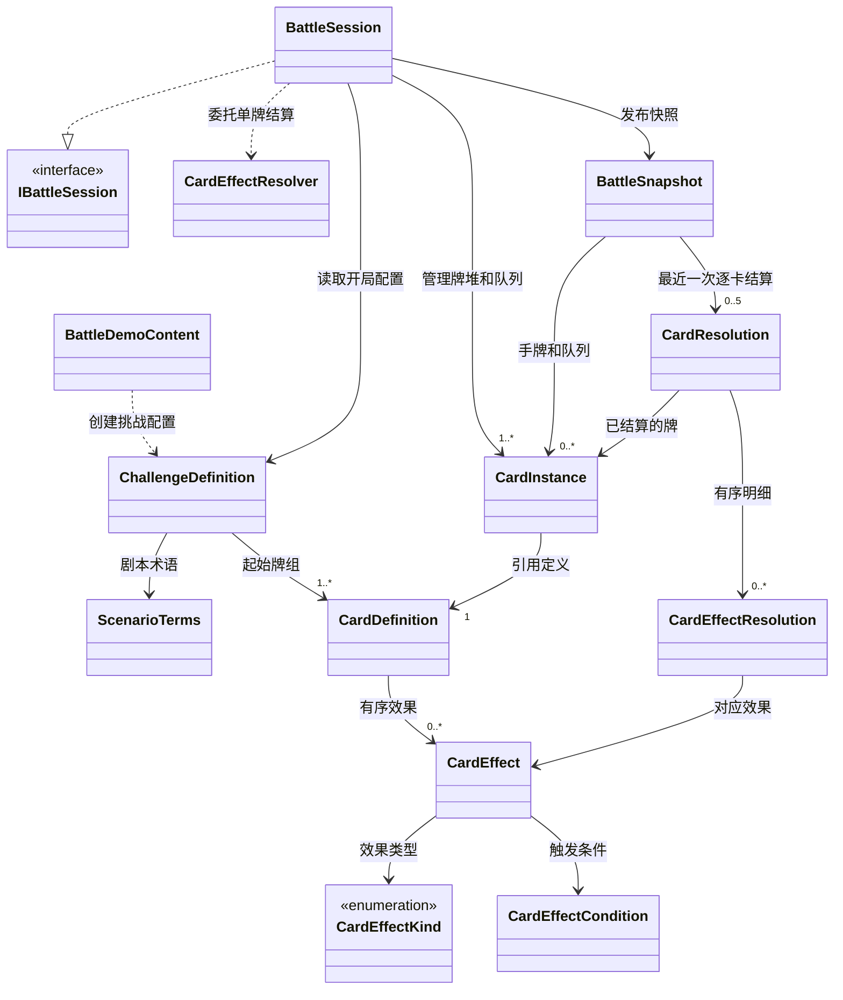

# 卡牌类与结算关系

卡牌由定义和实例组成。`CardDefinition` 描述一类牌的名称与效果，`CardInstance` 表示一场挑战中的一张牌。`BattleSession` 管理实例的位置，玩家结束回合时才按队列结算收益。

## 类关系



| 类型 | 职责 |
| --- | --- |
| `CardDefinition` | 保存稳定的内容 ID、显示名和只读效果列表。起始牌组可以多次引用同一个定义。 |
| `CardInstance` | 保存本场唯一的 `InstanceId` 与对应定义。两张「执行」共用同一个内容 ID，拖拽时通过各自的 `InstanceId` 区分。 |
| `CardEffect`、`CardEffectKind` 与 `CardEffectCondition` | 保存效果的类型、数值、段数和触发条件。效果保存在定义中，由 `CardEffectResolver` 按列表顺序判断和执行。 |
| `ChallengeDefinition` 与 `ScenarioTerms` | 配置起始牌组、回合上限、目标收益和基础抽牌数，并提供当前剧本的显示术语。四个演示剧本共用牌组，收益名称和设施类叫法取自 `ScenarioTerms`。 |
| `BattleSession` 与 `IBattleSession` | 会话拥有手牌、抽牌堆、弃牌堆和队列，负责移动卡牌、抽牌和结算。调用方通过接口读取快照和提交命令。 |
| `BattleSnapshot` | 提供手牌、五槽队列、当前收益、版本和上次结算记录。界面可以保留旧快照来对比变化。 |
| `CardResolution` 与 `CardEffectResolution` | 前者记录一张牌所在的槽位、总收益和总抽牌，后者记录单条效果的每段收益、收益段数以及实际抽牌数。 |

## 卡牌效果

| `CardEffectKind` | `Amount` 的含义 | 结算方式 |
| --- | --- | --- |
| `GainBenefit` | 每段收益 | 按 `RepeatCount` 结算，默认一段。多段仍只占一槽。 |
| `GainBenefitPerEarlierCard` | 每张前序牌的收益 | 乘以本回合已经结算的牌数。 |
| `GainBenefitPerLaterCard` | 每张后续牌的收益 | 乘以当前牌右侧仍在队列中的牌数。 |
| `Draw` | 请求抽牌的张数 | 抽牌堆用完时洗入弃牌堆。两堆都空时停止，记录实际抽到的张数。 |
| `GainBenefitPerDrawnCard` | 每张实际抽到的牌对应的收益 | 乘以本回合结算到此为止的实际抽牌数，包括同一卡上先执行的 `Draw`。回合开始的基础抽牌不计入。 |

例如把「调查」「执行」「整理」「协作」放进槽 `0`、`2`、`3`、`4`。若「整理」成功抽到一张，依次获得 `8 + 3`、`5 + 5`、`5 + 2`、`4 × 3`，总计 **40 点收益**。槽 `1` 为空，直接跳过。

### 触发条件

每条效果都能配置自己的 `CardEffectCondition`，默认是 `Always`。`BattleSession` 管理卡牌位置，`CardEffectResolver` 在轮到一张牌时逐条判断条件，执行收益或抽牌，并记录实际结果。

| 条件 | 含义 |
| --- | --- |
| `Always` | 执行效果。已有的两参数或固定收益段数构造方式使用此条件。 |
| `FirstCard` | 本卡是本轮第一个实际结算的卡牌。左侧空槽不影响判断。 |
| `LastCard` | 本卡是本轮最后一个实际结算的卡牌。右侧空槽不影响判断。 |
| `FullQueue` | 开始结算时五槽都有牌。轮到本卡时已经清掉的槽也算在内。 |
| `PreviousEffectDrewCards` | 同一张牌上紧邻的上一条效果实际抽到至少一张牌。 |

下面的效果组合先尝试抽一张，抽到以后才获得 3 点收益。

```csharp
var effects = new[]
{
    new CardEffect(CardEffectKind.Draw, 1),
    new CardEffect(CardEffectKind.GainBenefit, 3, CardEffectCondition.PreviousEffectDrewCards)
};
```

`EffectResolutions` 保留每条效果的顺序。条件未满足时该条的 `Applied` 为 `false`，收益段数与抽牌数都为零。抽牌效果执行后即便牌堆空了，`Applied` 仍为 `true`，此时实际抽牌数是零。

## 从开局到结算

1. `BattleDemoContent.CreateChallenge(scenario)` 生成开局配置。`BattleSession` 按起始牌组的每个位置生成一张独立实例，用给定种子洗牌并抽出首轮手牌。
2. 规划阶段，`PlaceCard(instanceId, slotIndex)` 将手牌放进空槽，也可把已入队的牌移到另一个空槽。`ReturnCard(instanceId)` 把牌移回手牌。队列固定五槽，索引为 `0` 到 `4`，`null` 表示空槽。放牌阶段只更改位置，收益在回合结算时产生。
3. `EndTurn` 先把未入队的手牌移进弃牌堆，再从左到右结算所有占用的槽。每张牌完成自己的全部效果后才进入弃牌堆，因此它无法抽到自己，后续卡牌可以抽到已经结算并洗回抽牌堆的牌。
4. 队列清空后，若仍有回合，结算中抽到的牌留在手上，再补抽下一回合的基础手牌。最后一轮结算完，累计收益达到目标即获胜。已达标且队列为空时，也能通过 `FinishChallenge` 提前完成。

## 界面接入

界面从 `IBattleSession.Snapshot` 读取手牌和队列。拖拽开始时记下卡牌实例 ID 和快照 `Revision`，松手时把它们交给 `Execute`。每条成功命令返回新快照。若提交时版本已经过期，命令会被拒绝，界面可用返回的快照重新同步。接入 Unity 时，在主线程依次提交同一场挑战的操作。

`EndTurn` 同步完成整轮结算。界面可读取返回快照中的 `LastResolvedTurn` 和 `LastResolutions`，按槽序播放 `CardResolution`。需要逐段展示时，再读取 `EffectResolutions` 里的 `BenefitPerGrant` 和 `BenefitGrantCount`。

## 源码入口

- 卡牌模板与实例见 [CardDefinition.cs](../src/Game.Contracts/CardDefinition.cs)。
- 效果配置和触发条件见 [CardEffect.cs](../src/Game.Contracts/CardEffect.cs)，执行逻辑见 [CardEffectResolver.cs](../src/Game.Core/CardEffectResolver.cs)。
- 会话接口与拖拽命令见 [BattleCommands.cs](../src/Game.Contracts/BattleCommands.cs)。
- 快照与两级结算记录见 [BattleSnapshot.cs](../src/Game.Contracts/BattleSnapshot.cs)。
- 起始牌组与示例效果见 [BattleDemoContent.cs](../src/Game.Content/BattleDemoContent.cs)。
- 抽牌、移牌与结算逻辑见 [BattleSession.cs](../src/Game.Core/BattleSession.cs)。
